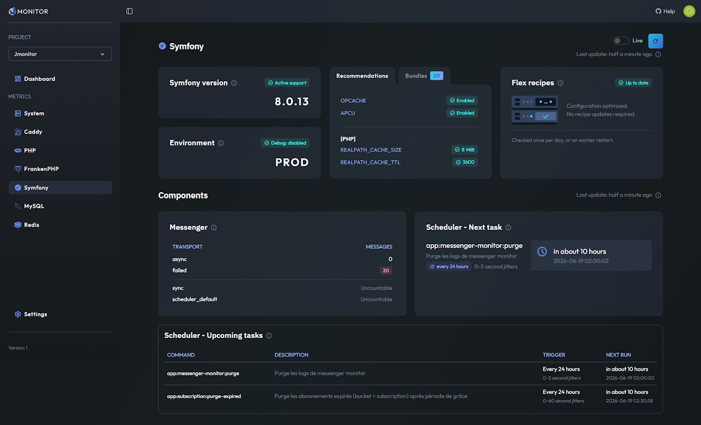

# Jmonitor Bundle

This bundle integrates the [*jmonitor/collector*](https://github.com/jmonitor/collector) PHP library into **Symfony**.    
It ships a **Symfony-specific collector** and a **console command** that runs the collectors in a **long-lived PHP worker process**.

[](https://packagist.org/packages/jmonitor/jmonitor-bundle)
[](https://github.com/jmonitor/jmonitor-bundle/actions)
[](LICENSE)
[](https://github.com/jmonitor/jmonitor-bundle/commits)

<table>
  <tr>
    <th valign="top"><a href="https://github.com/jmonitor/jmonitor">jmonitor/jmonitor</a><br>&nbsp;</th>
    <th valign="top"><a href="https://github.com/jmonitor/collector">jmonitor/collector</a><br>&nbsp;</th>
    <th valign="top">jmonitor/jmonitor-bundle<br></th>
  </tr>
  <tr>
    <td>Self-hostable backend — not needed with the cloud version</td>
    <td>The collectors — install them in the project to monitor</td>
    <td>Symfony-specific integration of the collectors</td>
  </tr>
  <tr>
    <td colspan="3" align="center">
      <a href="https://github.com/jmonitor/easyadmin-bundle">jmonitor/easyadmin-bundle</a><br>
      Live monitoring pages inside EasyAdmin — no backend, no worker
    </td>
  </tr>
  <tr>
    <td colspan="3" align="center">
      <a href="https://jmonitor.io">https://jmonitor.io</a>
    </td>
  </tr>
</table>



## Supported components

| Category          | Components                                                                                                                                                                                                                                                                                                |
| ----------------- | -------------------------------------------------------------------------------------------------------------------------------------------------------------------------------------------------------------------------------------------------------------------------------------------------------- |
| Runtime           |                                                                                                                                    |
| Framework         |                                                                                                                                                                                                      |
| Web servers       |           |
| Databases & cache |    |
| CDN               |                                                                                                                                                                                            |
| System            |                                                                                                                                                                                         |

## Requirements
- [](https://packagist.org/packages/jmonitor/jmonitor-bundle)
- [](https://packagist.org/packages/jmonitor/jmonitor-bundle)

## Getting started

### 1. Create your project

Create a project on [jmonitor.io](https://jmonitor.io) — or on your self-hosted instance — and copy its API key.

### 2. Install the bundle

```bash
composer require jmonitor/jmonitor-bundle
```

### 3. Configure the bundle

Store your API key in an environment variable:

```dotenv
# .env
JMONITOR_API_KEY=
```

```dotenv
# .env.prod
JMONITOR_API_KEY=your_api_key
```

Then enable the collectors matching your stack:

```yaml
# config/packages/jmonitor.yaml
jmonitor:
    # project_api_key can be empty to disable sending data to Jmonitor
    # useful for testing purposes in non-production environments
    project_api_key: '%env(JMONITOR_API_KEY)%'

when@prod:
    jmonitor:
        # Optional (recommended): use a specific logger service (Symfony's default is "logger").
        # See "Debugging" section below for more information.
        logger: 'logger'
    
        # Optional: provide a custom HTTP client service
        # http_client: 'http_client'
        
        # Enable the collectors you want to use (remove the unused ones).
        # Refer to the collector library for deeper collector-specific doc: https://github.com/jmonitor/collector
        collectors:
            # Cpu, Ram, Disk... Linux only.

            # You can use a RandomAdapter on Windows for testing purpose.
            # system:
            #     adapter: 'Jmonitor\\Collector\\System\\Adapter\\RandomAdapter'
            system: ~
            
            # Apache via mod_status module.
            # for more information, see https://github.com/jmonitor/collector?tab=readme-ov-file#apache
            apache:
                server_status_url: 'http://localhost/server-status'

            # Nginx via stub_status module.
            # for more information, see https://github.com/jmonitor/collector?tab=readme-ov-file#nginx
            nginx:
                endpoint: 'http://localhost/nginx_status'
            
            # MySQL - multiple sub-collectors available : status, variables, slow_queries, information_schema
            # all sub-collectors are enabled by default, disable some of them by setting them to false
            # Queries run through a Doctrine DBAL connection (default: doctrine.dbal.default_connection).
            # SlowQueries collector is configurable:
            # mysql:
            #     db_name: 'your_db_name'
            #     connection: 'doctrine.dbal.default_connection' # Doctrine DBAL connection service id
            #     slow_queries:
            #         limit: 5 # Maximum number of results to return (1-10)
            #         min_exec_count: 1 # Minimum number of executions required to include a query
            #         min_avg_time_ms: 0 # Minimum average execution time in ms for a query to be included.
            #         order_by: 'avg' # Allowed values: sum, avg, max
            mysql:
                db_name: 'your_db_name'

            # PostgreSQL - multiple sub-collectors available : activity, settings, database, slow_queries
            # all sub-collectors are enabled by default, disable some of them by setting them to false.
            # Queries run through a Doctrine DBAL connection (default: doctrine.dbal.default_connection).
            # The slow_queries sub-collector relies on the pg_stat_statements extension.
            # postgresql:
            #     connection: 'doctrine.dbal.default_connection' # Doctrine DBAL connection service id
            #     schema: 'public'                               # schema inspected by the database sub-collector
            #     slow_queries:
            #         limit: 5                  # Maximum number of results to return (1-10)
            #         min_exec_count: 1         # Minimum number of executions (calls) required to include a query
            #         min_avg_time_ms: 0        # Minimum mean execution time in ms for a query to be included
            #         order_by: 'avg'           # Allowed values: avg, total, max
            #         auto_create_extension: false # CREATE EXTENSION IF NOT EXISTS pg_stat_statements when missing
            postgresql:
                connection: 'doctrine.dbal.default_connection'

            # PHP : some ini keys, apcu, opcache, loaded extensions... 
            # /!\ See below for more informations about CLI vs Web-context metrics
            # CLI only:
            # php: ~
            # web metrics:
            php:
                endpoint: 'http://localhost/jmonitor/php-metrics'
            
            # symfony: some infos, loaded bundles, flex recipes, schedules...
            # Components are auto-detected based on installed packages.
            # You can disable a component by setting it to false, or configure it:
            # symfony:
            #     flex: false       # disable
            #     scheduler: false  # disable
            #     messenger: false  # disable
            #
            #     flex:
            #         command: "composer.phar recipes -o"  # default: "composer recipes -o"
            #         timeout: 10                          # default: 5 (seconds)
            #     Note: flex recipes are checked once per day and cached for the rest of the worker process lifetime.
            #     A failed check (e.g. network timeout) is retried after one hour; if composer cannot be run, the check is disabled until the worker restarts.
            #
            #     messenger:
            #         command: "php bin/console messenger:stats --format=json"  # default: auto
            #         timeout: 5                                                # default: 3 (seconds)
            symfony: ~

            # Redis metrics via INFO command
            # you can use either DSN or a service name (adapter).
            # redis:
            #     dsn: '%env(SOME_REDIS_DSN)%'
            #     adapter: 'some_redis_service_name'
            redis:
                
            # Metrics from Caddy / FrankenPHP
            # see https://caddyserver.com/docs/metrics and https://frankenphp.dev/docs/metrics/
            caddy:
                endpoint: 'http://localhost:2019/metrics'
                frankenphp: true # default is false

            # Cloudflare: what your server cannot see (cache, security, edge latency, Web Analytics, R2, Images)
            # Token permissions: https://github.com/jmonitor/collector?tab=readme-ov-file#cloudflare
            # This collector calls a remote API: the refresh intervals keep it within Cloudflare's rate limits,
            # lowering them is rarely useful.
            # Without any http_client, the collector uses a client with a 5-second timeout. Give the one you pass
            # a timeout too: an unanswered Cloudflare call would otherwise hold up the whole worker.
            # cloudflare:
            #     http_client: 'some_psr18_client' # default: the bundle http_client, then discovery
            #     refresh:                         # seconds
            #         traffic: 60
            #         today: 300
            #         web_analytics: 300
            #         storage: 900                 # r2 and images
            #         zone: 3600
            #     lag: 180                         # seconds: the data window ends at the start of the minute of now - lag
            #     lookback: 5                      # minutes of per-minute traffic re-read on every refresh (60 at most)
            #     window: 15                       # minutes covered by the traffic breakdowns
            cloudflare:
                api_token: '%env(CLOUDFLARE_API_TOKEN)%'
                zone: 'example.com' # zone name or zone id
```

### 4. Run the worker

The bundle ships a **console command that runs the collectors in a long-lived worker process**. This means you
**must not** collect metrics on every web request.

First, check your setup with a dry run — it collects the metrics and prints them without sending anything.
It is often easier to do this in the production environment, since configuring the bundle (or some collectors)
in development is not always possible.

```bash
php bin/console jmonitor:collect -vvv --dry-run
```

You can pass a collector name as an argument to run only that one, which helps to debug a specific integration:

```bash
php bin/console jmonitor:collect mysql -vvv --dry-run
```

Once everything looks right, run it for real:

```bash
php bin/console jmonitor:collect
```

### 5. Run it in production

Run the command under a process manager (Supervisor, systemd…) so it stays up and is restarted periodically.
Symfony Messenger's recommendations apply as-is:
https://symfony.com/doc/current/messenger.html#deploying-to-production

Some metrics are fairly static and remain cached for the lifetime of the process, so among other reasons
(memory…), it is **strongly recommended** to restart the worker regularly, at least once a day. Two options
are available for that:

- `--time-limit`: stop after the given number of seconds
- `--memory-limit`: stop when the process memory usage exceeds the given limit (e.g. `128M`)

```bash
php bin/console jmonitor:collect -vv --memory-limit=32M --time-limit=3600
```

## Application monitoring (preview)

The bundle can also record the HTTP requests your application serves, with the SQL queries, outgoing HTTP calls, cache reads, writes and deletes, exceptions and signed-in users behind them, and show them on a `/jmonitor` page, over the last hour, 6 hours, 24 hours or 7 days:

- **Requests** (`/jmonitor/`): requests, response times (average, p95, max), SQL time and number of queries, time spent in outgoing HTTP calls (`HTTP out`), slow requests, 5xx errors and peak memory, per route.
- **Queries** (`/jmonitor/queries`): executions, total, average and maximum time and slow executions per SQL query, and the queries repeated within one request (N+1).
- **HTTP client** (`/jmonitor/http-client`): calls, total, average and maximum time, 4xx and 5xx responses and network failures, per called host.
- **Cache** (`/jmonitor/cache`): hits, misses, hit rate, writes and deletes, per cache pool.
- **Exceptions** (`/jmonitor/exceptions`): count and last occurrence per exception class, and per class and route.
- **Users** (`/jmonitor/users`): requests, total and average time, slow requests and 5xx errors, per signed-in user.

A screen only appears when its component is installed and its recording option is on: HTTP client needs the `http_client` service of the framework, Users needs the SecurityBundle.

Only HTTP requests are covered for now: what console commands and message consumers do is not recorded.

It needs a Doctrine DBAL connection (MySQL/MariaDB, PostgreSQL or SQLite, typically through `doctrine/doctrine-bundle`) and the TwigBundle; without the TwigBundle the page answers 404. Nothing else to set up: the `jmonitor_aggregates` and `jmonitor_keys` tables are created automatically in the configured connection, upgraded automatically when a new version of the bundle changes them, and Doctrine migrations will not try to drop them. Tables created by an earlier development build of 3.x are dropped and recreated, losing the metrics they held. Your database receives batched writes, at most once per `flush_interval` per server, never one write per request or per query.

If the database user of your application is not allowed to create tables, run `php bin/console jmonitor:setup` at deployment with a user that is. It creates or upgrades the two tables, or tells you they are up to date.

Import the routes (the bundle assets are published by `assets:install`, which Symfony Flex runs automatically):

```yaml
# config/routes/jmonitor.yaml
jmonitor:
    resource: '@JmonitorBundle/config/routes.php'
    prefix: /jmonitor
```

If your routes carry a `host`, give this import the same `host`. If your `access_control` ends with a catch-all rule, add a rule that covers `/jmonitor` before it.

Defaults, all optional:

```yaml
# config/packages/jmonitor.yaml
jmonitor:
    recording:
        enabled: ~            # default: true, except in the "test" environment
        flush_interval: 10    # seconds between two writes to the database (3600 maximum)
        slow_threshold: 1000  # ms above which a request counts as slow
        ignore_routes: []     # route names not recorded, fnmatch patterns allowed (e.g. 'app_health*')
        buffer_dir: ~         # where the buffer gets its private subdirectory, must exist and be writable by every user running PHP; default: the system temporary directory
        sql:
            enabled: true             # record the SQL queries run through Doctrine DBAL
            slow_threshold: 100       # ms from which a query counts as slow
            n_plus_one_threshold: 10  # executions of the same SELECT within one request that make an N+1
        exceptions: true      # count the exceptions behind 5xx responses
        users: true           # record the requests of each signed-in user (needs the SecurityBundle)
        http_client: true     # record the outgoing calls of the http_client service and the scoped clients
        cache: true           # count the reads, writes and deletes of cache.app and of the pools you declare
    storage:
        connection: 'default' # name of the Doctrine DBAL connection
        retention: 604800     # seconds the data is kept (7 days, 3600 minimum)
    dashboard:
        enabled: true         # false: the page answers 404
        permission: ~         # role or voter attribute required to see the page
```

`recording.enabled` can come from an environment variable, read at runtime, to switch recording off without a new deployment:

```yaml
jmonitor:
    recording:
        enabled: '%env(bool:JMONITOR_RECORDING)%'
```

### Access

- Without `dashboard.permission`, the page is open in debug mode and answers 404 otherwise.
- With `dashboard.permission`, for example `ROLE_ADMIN`, the page requires that permission in every environment. This option needs the SecurityBundle.
- The route must sit behind one of your firewalls: outside any firewall nobody is authenticated, so the page is denied to everyone.

### What is recorded

Main requests only. Not recorded: any route whose name starts with `jmonitor_`, the web debug toolbar and profiler, sub-requests, and the routes matching `ignore_routes`. A request that matches no route is recorded as `(unmatched)`. Methods other than GET, HEAD, POST, PUT, PATCH, DELETE and OPTIONS are grouped under `OTHER`.

SQL queries: every query run through Doctrine DBAL during a recorded request, on every connection. The values bound to a query as parameters are never read, so they are never stored. The query text is read with the rules of the database of its connection (MySQL or MariaDB, PostgreSQL, SQLite): its comments are removed, the numbers and strings written in it are replaced by `?`, and its `IN (…)` and multi-row `VALUES (…)` lists are folded. A double-quoted token is a string under MySQL, always replaced; an identifier under PostgreSQL, kept; and under SQLite, which accepts both, replaced only where a value is expected (right after `=`, `<`, `>` or `LIKE`, in a `VALUES (…)` list, or in an `IN (…)` list made only of values), so a double-quoted value anywhere else is kept. A query whose text cannot be delimited with certainty is counted on the `Other queries` row and its text is not kept, for instance an unterminated string or comment, a backslash whose meaning depends on a session setting of the server when the possible readings differ, a MySQL optimizer hint or versioned comment that is not plain (letters, digits, parentheses, commas…), or a text longer than 64 KiB. So is every query of a connection to another database, or of a connection whose `charset` option or a driver option such as an init command names a multi-byte encoding in which a backslash can be part of a character (Big5, GBK, GB18030, Shift_JIS…); such an encoding set another way, by the server default or a `SET NAMES` query, is not detected, and a value can then survive. This reading assumes the server accepts the query: a query the server rejects can be stored with a value in it, so pass sensitive values as bound parameters rather than concatenating them into the SQL. The same `SELECT` run at least `n_plus_one_threshold` times (10 by default) within one request is reported as an N+1.

Exceptions: only the class of the exception is kept, and only when the final response of the request is a 5xx. Its message, file and stack trace are never kept.

Users: the identifier of the signed-in user (`getUserIdentifier()`, often a username or an email address) is stored in clear in your application database, in the `jmonitor_keys` table. Set `recording.users: false` to go without it. It needs the SecurityBundle. Anonymous requests are not counted, and under `switch_user` the request counts for the impersonated user. A request is attributed to a user only when your application resolved the user during that request: JMonitor never triggers a lazy authentication itself, so the public pages a signed-in user visits may not be counted.

Outgoing HTTP calls: only the calls made through the `http_client` service and the scoped clients declared under `framework.http_client.scoped_clients` are seen, that is the clients your application receives by injection. A client created by hand with `HttpClient::create()`, Guzzle or curl is not seen. Only the host and port of a call are kept, never its scheme, credentials, path or query string. A retried call counts once, and its duration covers every attempt and the pauses between them. `HTTP out` adds up the durations of the calls of a request, so concurrent calls can make it longer than the request itself.

Cache: `cache.app`, whatever its adapter, and the pools declared under `framework.cache.pools` in YAML or PHP are counted. Not counted: the declared pools built on the system adapter (`cache.adapter.system`), those with `early_expiration_message_bus`, and the pools Symfony or other bundles create for their own use. Only counters are kept: hits, misses, writes and deletes per pool, never a key nor a value.

Each flush keeps the 300 most requested routes (method and route) of its batch; the requests of the others are added up on an `Other routes` row. Only the heaviest queries, by total time, are tracked individually, about 200 per server; the others are added up on an `Other queries` row. Likewise, about 200 users, the most active, and 50 hosts, by total time, are tracked individually per server, and each flush keeps 20 cache pools, 50 exception classes and 100 couples of a class and a route; the rest is added up on an `Other …` row. Under heavy load the detail of a request (its queries, user, outgoing calls, cache operations and exception) is sampled, while the requests themselves, with their SQL time, number of queries and time spent in outgoing calls, are always counted.

Requests are buffered in files, in a subdirectory of the system temporary directory (or of `buffer_dir`) that only the user running PHP can access; the text of the recorded queries and the identifiers of the signed-in users are kept there too. When the web server and the console run as different users, each keeps and flushes its own buffer. `buffer_dir` must exist and be writable by every user that runs PHP: JMonitor never creates it, and while it is missing the system temporary directory is used instead, with a warning in the logs. When that subdirectory cannot be used, nothing is recorded and the page shows "Buffer directory unusable".

Recording is off by default in the `test` environment. Forcing it on with a test setup that keeps the connection inside a transaction (e.g. `dama/doctrine-test-bundle`) only logs refused flushes: nothing is written while a transaction is open.

## PHP metrics: CLI vs Web context

- PHP settings and extensions can differ significantly between CLI and your web server context.
- If you want metrics that reflect your web runtime, you must expose a tiny HTTP endpoint that returns PHP metrics from within that web context.

To do that, create a route config file: 

```yaml
# config/routes/jmonitor.yaml
jmonitor_expose_php_metrics:
    path: '/jmonitor/php-metrics'
    controller: Jmonitor\JmonitorBundle\Controller\JmonitorPhpController

# Secured route in production with localhost host restriction
# Refer to symfony docs for more information about security
when@prod:
    jmonitor_expose_php_metrics:
        path: '/jmonitor/php-metrics'
        controller: Jmonitor\JmonitorBundle\Controller\JmonitorPhpController
        host: localhost
```

Set up a firewall for this route **before** the main firewall to prevent your app from interfering with it:
```yaml
# config/packages/security.yaml
security:
    firewalls:
        jmonitor:
            pattern: ^/jmonitor/php-metrics$
            security: false
            # instead of disabling security, you can use a stateless firewall if you plan to use ip security or something
            # stateless: true
        main:
        # ...
```

Wire it in your bundle config
```yaml
# config/packages/jmonitor.yaml
jmonitor:
    # ...
    collectors:
        php:
            endpoint: 'http://localhost/jmonitor/php-metrics'
```

## Logging and Debugging
- The command is resilient: individual collector failures do not crash the whole run; errors are logged (logging must be enabled in config).
- Symfony component collectors (scheduler, messenger) that fail at worker startup are disabled for the lifetime of that worker process and an error is logged. Restart the worker to re-enable them.
- Log levels:
    - Errors (collector exceptions, HTTP responses with status >= 400): error
    - Collected metrics: debug
    - Summary: info

## Troubleshooting

### Apache
> mod_status is enabled, but my endpoint is not reachable.

Don't forget to let the request pass through your index.php.  
For example, if you use .htaccess :
```
RewriteCond %{REQUEST_FILENAME} !-f
RewriteCond %{REQUEST_URI} !=/server-status    <---- add this
RewriteRule ^ %{ENV:BASE}/index.php [L]
```

## Need help?
- Anything about this bundle — installation, Symfony configuration, the `jmonitor:collect` command, the Symfony collector: open an issue on this repo https://github.com/jmonitor/jmonitor-bundle/issues
- Anything about a metric — a missing or wrong value, a collector that does not gather what you expect: open an issue on https://github.com/jmonitor/collector/issues
- Anything about the app itself — dashboards, alerts, [dash.jmonitor.io](https://dash.jmonitor.io): open an issue on https://github.com/jmonitor/jmonitor/issues
